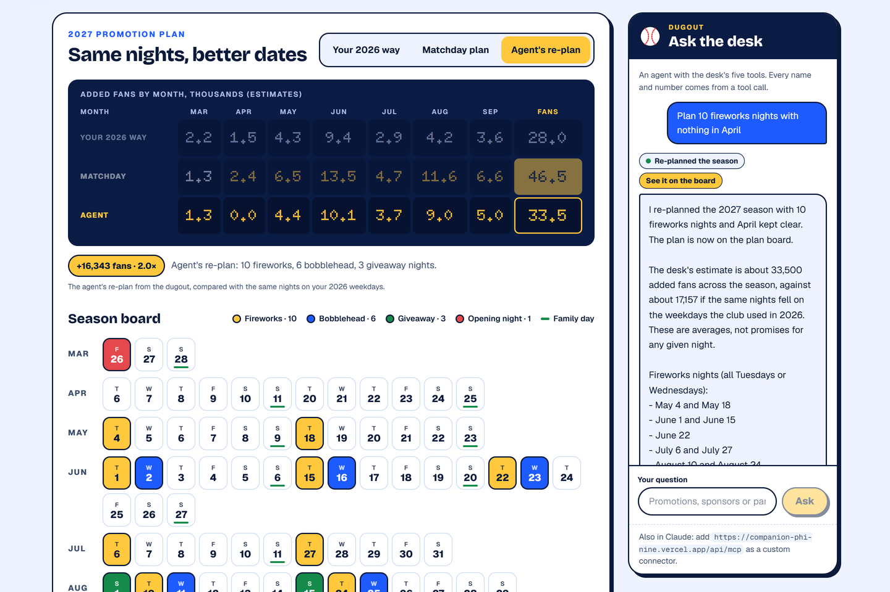
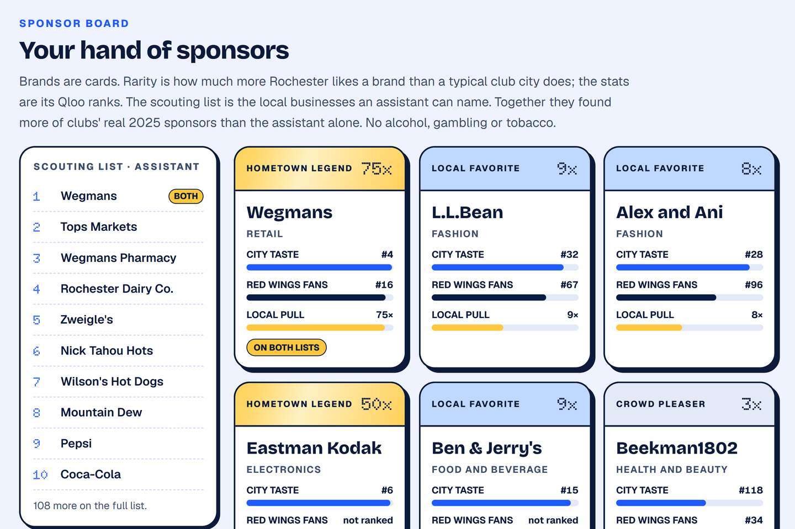

# Matchday Revenue Desk

A season-planning desk for the marketing and sponsorship staff of baseball clubs. Pick any of the 150 MLB and affiliated Minor League clubs, and the desk:

- moves the club's fireworks, bobblehead and giveaway nights to the 2027 dates where measured attendance lift adds the most fans;
- suggests family theme nights the club's own town is likely to love: films, shows and characters other clubs built nights on, ranked by how the area around the ballpark leans toward each in Qloo's taste data, never a drinking or gambling night;
- deals a hand of sponsor prospects that the club's city and its fans rank high in [Qloo](https://qloo.com)'s taste graph, next to the local businesses an AI assistant can name;
- maps family restaurants, cafes and bakeries around the ballpark that stay open through a night game (bars, pubs and breweries are left out);
- answers questions and re-plans the season through an agent that uses the desk's own tools. The same tools work inside Claude as an MCP connector.

**Live app:** https://companion-phi-nine.vercel.app (free, no sign-in)
**MCP endpoint:** `https://companion-phi-nine.vercel.app/api/mcp` (in Claude: Settings → Connectors → add a custom connector)



## An example: Rochester Red Wings

The plan keeps the club's own 2026 mix (21 fireworks nights, 6 bobbleheads, 3 giveaways and opening night) and changes only the dates. Placed on the 2027 home schedule where the measured lift is largest, it adds an estimated **46,500 fans** across the season, against **28,000** for the same nights on the weekdays the club used in 2026: **+18,579 fans, 1.7×**. These are averages from two seasons of real games, not promises for any one night.

Ask the agent "Plan 10 fireworks nights with nothing in April" and it calls `plan_season`, puts the re-plan on the board as a third view, and compares it the same way.

## How it works

### Season plan

1. **Lift model.** Every regular-season MLB and Minor League game of 2025 and 2026 (20,711 games) from the MLB Stats API. Log attendance is regressed on promotion flags with club-season, weekday, month, day/night, temperature and rain controls, with errors clustered by club (`analysis/lift.py`).
2. **Planner.** Each 2027 home date gets a baseline crowd: the club's no-promotion average for that weekday, scaled by month. Each promotion goes where its measured lift adds the most fans, with Monday-to-Thursday lifts used midweek and a minimum gap between nights of one kind (3 days for fireworks, 5 for bobbleheads), in `src/lib/plan/season.ts`.
3. **A fair comparison.** "Your 2026 way" places exactly the same nights on the weekdays the club used in 2026, so only the dates differ. 2027 start times aren't published yet, so a weekday the club mostly played in daylight in 2025–26 (usually Sunday) counts as a day game and gets no fireworks.

### Family theme nights (Qloo)

124 of the 150 clubs ran a Star Wars promotion in 2026. Theme nights mostly copy what works elsewhere, so the desk asks a different question: which of the subjects clubs build family nights on does *this* town lean toward more than other club towns?

1. **Subjects clubs actually use.** Every 2025–26 "Theme Days" promotion name (2,523 of them) was read by Claude Haiku 5.5 for the pop-culture subject it is built on, and whether that subject suits all ages (`analysis/theme-subjects.mts`). Subjects are resolved in Qloo with `/search`. Kept: family-safe subjects with nights at three or more clubs, such as Star Wars, Bluey, Harry Potter, Toy Story, Sesame Street and PAW Patrol.
2. **How each town leans.** One national Qloo heatmap per subject (`filter.type=urn:heatmap`, the subject as `signal.interests.entities`), then the popularity-weighted mean affinity of the cells within 60 km of each ballpark (`analysis/theme-heatmaps.mts`). Each club's ideas are the subjects its area out-ranks most other club towns for, placed on the plan's theme nights, family days first.
3. **Family-safe only.** Nothing about drinking, gambling, tobacco or cannabis, no film rated R, and the desk leaves out a few acts tied to drug culture. Community nights (faith and family, military, first responders, teachers, heritage) stay the club's own choice: the desk doesn't rank them by taste.
4. **Any idea, live.** The agent's `check_theme_night` asks Qloo for one heatmap of whatever subject someone names, and says how the town compares with every club town.

### Sponsor board (Qloo)

For every club, ahead of time (`scripts/precompute.mts`):

- **The club in Qloo:** `/search` with `types=urn:entity:brand`, accepted only on an exact name match.
- **City taste:** `/v2/insights` with `filter.type=urn:entity:brand` and `signal.location.query` set to the club's city, 300 brands.
- **Fan base:** the same call plus `signal.interests.entities` set to the club, 300 brands.
- **Local lift:** how much higher a brand ranks in this city than in a typical club city. It sets a card's rarity, so Wegmans in Rochester is a "Hometown legend" at 75×.

The Desk ranking fuses the city and fan-base ranks by reciprocal rank and boosts brands with strong local lift (`src/lib/sponsors/rank.ts`). Beside the cards, a scouting list holds the local businesses Claude Haiku 5.5 names for the club. The board shows both because the pre-registered test below found that they catch different sponsors. A model reads every name once and flags alcohol, gambling, tobacco and cannabis brands; those, plus crypto and firearms brands, stay off the live board.

### Food partners (Qloo)

`/v2/insights` with `filter.type=urn:entity:place`, a 3 km radius around the ballpark and the club as the interest signal, so places are ranked by how much the club's fans like them. Restaurants, cafes and bakeries are kept; anything that reads as a bar, pub, brewery or taproom is dropped (`src/lib/partners/partners.ts`). Opening hours from Qloo mark which places stay open through a 17:30–22:00 game.

### Agent and MCP

"Ask the desk" runs on the AI SDK (`streamText`) with Claude Haiku 5.5 through the Vercel AI Gateway. The model chooses the tool calls and writes the answer; every name and number comes from a tool:

| Tool | What it does |
|---|---|
| `find_clubs` | Find any of the 150 clubs by name or city |
| `plan_season` | Re-plan a club's 2027 nights: change counts, skip months |
| `family_themes` | Family theme night ideas the club's town ranks high for, with dates from the plan |
| `check_theme_night` | Asks Qloo live how the club's town leans toward any family theme, against every club town |
| `sponsor_board` | Both sponsor lists with their Qloo evidence, filtered by category |
| `nearby_partners` | Family food places near the park, open on a given game night |
| `get_evidence` | The test results below and their limits |

The same registry is served at `/api/mcp` over streamable HTTP (stateless, no sign-in). The public demo has daily per-visitor and overall limits on the agent.

## Evidence

All three tests were written down and committed before they ran ([docs/eval-plan.md](docs/eval-plan.md)), and the results are reported as they came out, including the one that went against the product. The live [Evidence page](https://companion-phi-nine.vercel.app/proof) shows the same numbers.

**What promotions do to attendance** (95% intervals):

| Promotion | MLB (4,900 games) | Minor leagues (15,811 games) |
|---|---|---|
| Fireworks | +9.1% (4.5 to 13.9) | +21.7% (17.7 to 25.8) |
| Fireworks, Mon–Thu | +16.6% | +41% |
| Bobblehead | +6.9% (2.4 to 11.6) | +12.2% (8.1 to 16.5) |
| Other giveaway | +6.0% (2.9 to 9.2) | +10.0% (6.5 to 13.6) |
| Theme night | +1.9% (−1.1 to 5.1) | +6.4% (2.9 to 10.0) |
| Ticket offer | +0.7% (−2.5 to 4.0) | +1.1% (−2.8 to 5.2) |
| Opening day | +30.1% (15.7 to 46.3) | +41.1% (32.2 to 50.6) |

Fitted on 2025 and checked on 2026, 11 of the 12 promotion estimates stayed inside their 2025 ranges (the miss is minor league bobbleheads). Promotions shift the season average but barely improve a single game's forecast, because weather, opponents and everything else dominate any one night.

**Does the sponsor board find real sponsors?** Labels are the presenting sponsors clubs published for their own promotions, and a ranked brand counts when its name matches one. Top 300 brands per club, 2,000 bootstrap resamples of clubs:

| Ranking | 2026 sponsors found (114 clubs, 3,065 labels) | 2025 sponsors found (110 clubs, 2,795 labels) |
|---|---|---|
| Desk: Qloo city taste + fan base | 136 | 122 |
| Qloo city taste only | 130 | 115 |
| Assistant only (Claude Haiku 5.5) | 248 | 233 |
| **Hybrid: assistant top 150 + Desk top 150** | not run | **262** |
| Placebo: another club's city | 31 | 28 |

- **The pre-registered test failed.** The Desk ranking found 112 fewer 2026 sponsors than the assistant alone (range −158 to −66). It beat the placebo by 105 (82 to 131), so the taste signal is real, but most real sponsors are local banks, hospitals and dealers that an assistant can name and Qloo doesn't cover.
- **The two find different sponsors,** so a hybrid was written down first and tested on a different season. It found 29 more 2025 sponsors than the assistant alone at the same list length (12 to 48). That is why the board shows both lists.

**Do towns turn out for themes they love?** 354 theme nights in 2025–26 were built on 26 family-safe subjects that three or more clubs used. Each night's crowd is measured against what the attendance model expects for a theme night at that club on that date. It is then compared only with nights on the same subject elsewhere, so national popularity drops out. Spearman correlation, 95% intervals from 2,000 bootstrap resamples of clubs:

| Town score | Correlation with the crowd | Nights |
|---|---|---|
| Qloo: how the area around the ballpark leans toward the subject (heatmap) | +0.08 (−0.06 to 0.22) | 325 |
| Qloo: the town's taste (location insights; covers 10 of the 26 subjects) | +0.03 (−0.16 to 0.21) | 144 |
| Assistant only (Claude Haiku 5.5) | −0.05 (−0.18 to 0.08) | 353 |
| Placebo: another club's area | −0.16 (−0.27 to −0.04) | 329 |

- **It didn't show.** How an area leans toward a subject didn't reliably predict which of its theme nights drew more. The Qloo heatmap score points the right way and is ahead of the assistant (+0.11, range −0.06 to 0.31), but neither interval excludes zero.
- **Single nights are noisy:** even the placebo landed away from zero.
- **So the desk calls the theme ranking untested** on every club page. It still lists the subjects each town leans toward, as ideas, which is what the rule written before the test said it would do.

**What this does not establish:** lifts are observed associations (clubs choose when to run promotions), not experiments. Sponsor labels show who bought, not who should. Many sponsors renew every year, so 2025 overlaps 2026. The assistant may remember published sponsor deals from its training data, which favours it in both tests.



## Architecture

- **App:** Next.js 16 (App Router) on Vercel, Tailwind CSS v4, Postgres on Neon.
- **Precomputed data:** Qloo results, assistant lists and brand-safety flags are built per club ahead of time and loaded into Postgres, so a visitor never waits on or spends an API call. Raw Qloo output and raw game rows stay out of the repository (`data/cache` and `data/raw` are ignored); only derived aggregates such as the lift coefficients are committed.
- **Tests:** `npm test` runs the Vitest suite (Qloo client and parameters, planner, sponsor ranking and categories, partner filtering, agent tools).

## Run it locally

```bash
npm install
cp .env.example .env.local    # then fill in the values it lists
psql "$DATABASE_URL" -f db/schema.sql

# Build the data: MLB Stats API, then Qloo, then the assistant lists
node scripts/teams-baseball.mjs 2026
node scripts/pull-games.mjs 2025 2026
node scripts/pull-schedule.mjs 2027
node scripts/night-share.mjs
npx tsx scripts/precompute.mts
npx tsx scripts/ai-prospects.mts
npx tsx scripts/classify-prospects.mts
npx tsx scripts/load-db.mts 2027

npm run dev
```

## Data and credits

- Taste data: [Qloo](https://qloo.com) Insights API.
- Games, attendance, promotions and schedules: the MLB Stats API, used only as aggregates. Matchday is not affiliated with MLB or any club.

Built in coordination with an AI coding assistant, Claude Code.

## License

MIT, see [LICENSE](LICENSE).
